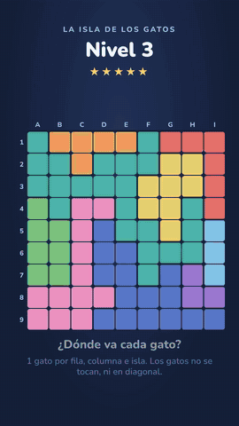
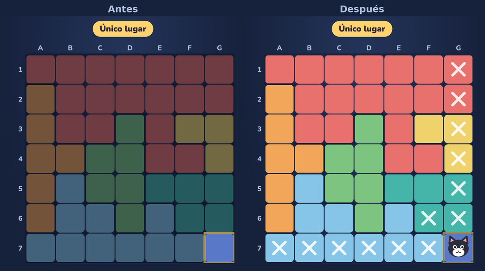
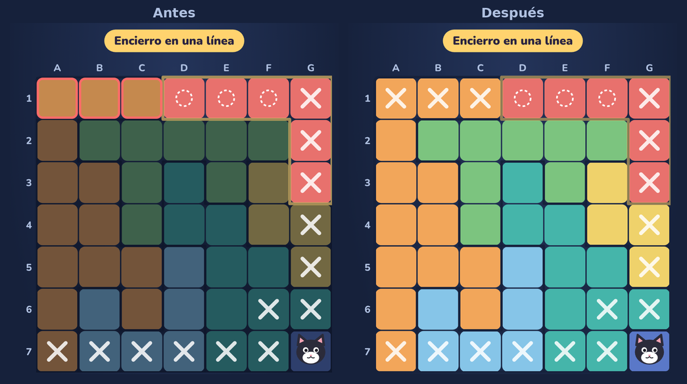
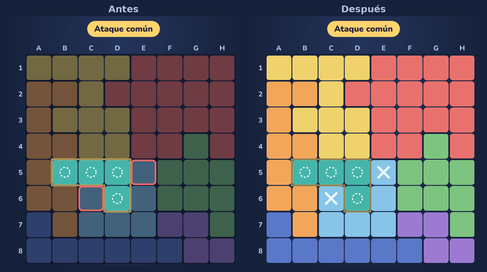
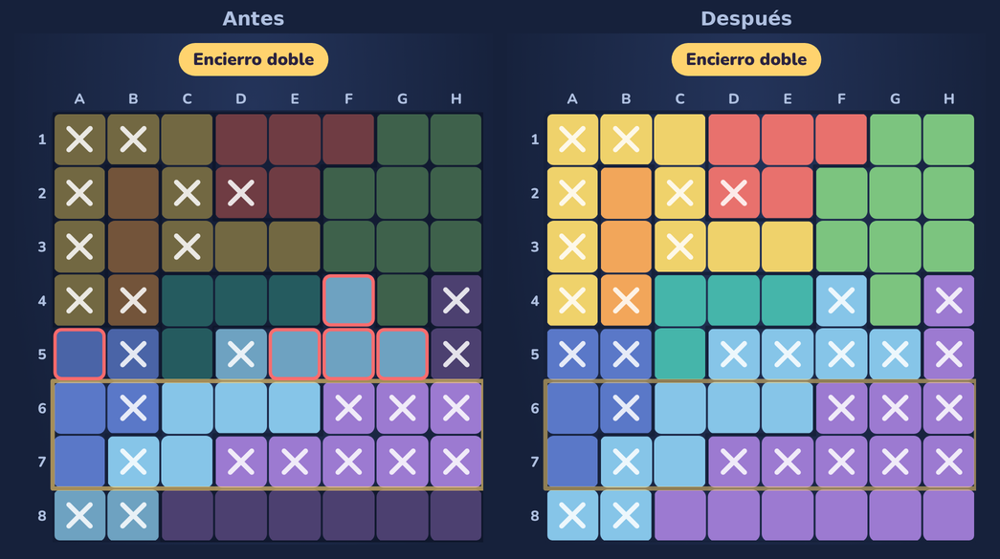
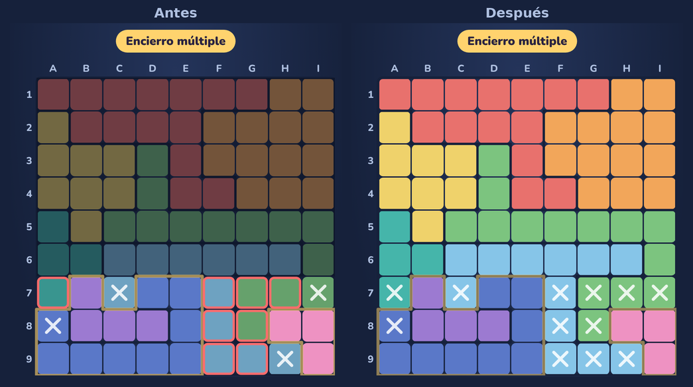
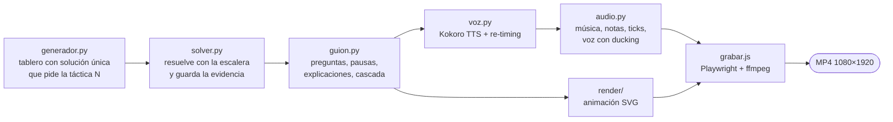

<h1 align="center">🐈‍⬛ La Isla de los Gatos</h1>

<p align="center">
  <b>Videos cortos que resuelven puzzles de lógica explicando el razonamiento, paso a paso.</b><br>
  Tableros generados por computadora · resueltos con tácticas humanas · narrados con voz sintética.
</p>

<p align="center">
  <a href="https://fetnelio.github.io/isla-de-los-gatos/#ep1"></a>
  &nbsp;
  <a href="https://fetnelio.github.io/isla-de-los-gatos/#ep2"></a>
  &nbsp;
  <a href="https://fetnelio.github.io/isla-de-los-gatos/#ep3"></a>
</p>

<p align="center">
  <b>▶ <a href="https://fetnelio.github.io/isla-de-los-gatos/">Ver los videos con sonido</a></b><br>
  <sub>Vista previa acelerada · tocá cada una para ir al video completo.<br>
  Ep. 1 ★★ encierro en una línea · Ep. 2 ★★★★ encierro doble · Ep. 3 ★★★★★ contradicción</sub>
</p>

---

## El puzzle

El tablero de N×N está dividido en N **islas** de colores. Hay que ubicar N gatos de forma que haya:

1. **un gato por fila**,
2. **un gato por columna**,
3. **un gato por isla**,
4. y **ningún par de gatos se toque**, ni siquiera en diagonal.

Cada tablero tiene **una sola solución**, y siempre se llega a ella razonando, sin adivinar.

Es el género conocido como **Star Battle** (Hans Eendebak, Campeonato Mundial de Puzzles 2003)
en su versión de una estrella, popularizada como **Queens** en LinkedIn.

## La idea

Un solver por fuerza bruta (*backtracking*) encuentra la respuesta, pero no se parece en nada a cómo piensa una persona.
Este proyecto resuelve cada tablero con una **escalera de tácticas humanas**, siempre usando la más simple que sirva,
y guarda **la evidencia de cada paso**. Ese registro se convierte en el **guion del relator**:

- la primera vez que aparece una táctica, el relator **pregunta** ("¿qué ven en la isla celeste?"), hace una pausa y **explica**;
- las veces siguientes la despacha con una frase corta ("acá lo mismo", "esto ya sabemos cómo sale");
- al final, cuando los gatos caen solos, viene **la cascada**: el momento ASMR, con notas que suben.

Cierre de cada episodio: *"Cada gato en su isla... y cada isla con su gato."* 🐾 *Michi, michi, miau.*

---

## La escalera de tácticas

Todas las imágenes salen de pasos reales del solver, dibujados con el mismo render de los videos.
En el **antes**, el contorno amarillo marca el grupo que se analiza, los anillos punteados sus lugares libres
y los bordes rojos las casillas que se van a tachar.

### 0 · Barrido

Cada gato que se ubica tacha su fila, su columna, su isla y las 8 casillas que lo rodean.
Va incluido en cada paso.

### 1 · Único lugar

> A una isla, fila o columna le queda **una sola casilla libre** → ahí va el gato.



El caso más evidente es una isla de una sola casilla. A medida que se tachan casillas, cualquier grupo puede quedar en esa situación.

### 2 · Encierro en una línea

> Todos los lugares libres de una isla caen en **una misma fila o columna** → esa línea es de la isla: el resto de la línea se tacha.
> (Y al revés: si una fila solo tiene lugar dentro de una isla, el resto de la isla se tacha.)



*"El gato de la isla roja solo puede estar en la fila 1. Así que la fila 1 es suya: el resto se tacha."*

### 3 · Ataque común

> Si **todas** las casillas libres de un grupo atacan a una misma casilla, esa casilla se tacha: pase lo que pase, el gato del grupo la va a tocar.



Es la misma idea que *"si pongo un gato acá, la isla B se queda sin lugar → acá no va"*, vista desde el otro lado.
Cubre los clásicos del dominó (2 casillas) y las formas en L.

### 4 · Encierro doble

> **Dos** grupos que solo caben en **dos** líneas (o islas) → esas líneas son suyas: todo lo demás en ellas se tacha.



*"La fila 6 y la fila 7 solo caben en la isla celeste y la isla azul. Esos lugares son suyos: lo demás se tacha."*

### 5 · Encierro múltiple

> Lo mismo con **k ≥ 3** grupos. Es fácil de enunciar y difícil de ver.



*"La isla azul, la isla violeta y la isla rosa solo caben en la fila 7, la fila 8 y la fila 9."*

### 6 · ¿Y si...? (contradicción)

> Se supone un gato en una casilla. Eso **obliga** a poner otro gato, y entonces algún grupo **se queda sin lugar**. ¡Imposible! → la casilla se tacha.


*"Si va en E4, se fuerza un gato en G5... y la isla turquesa se queda sin lugar. ¡Imposible! Entonces E4 es X."*
En rojo, las casillas que atacan los gatos supuestos; con borde rojo, la isla que queda vacía.

### 7 · Contradicción larga

> Igual que la anterior, pero para llegar al absurdo hay que usar tácticas 1 a 5 dentro de la suposición.


La **dificultad** de un tablero (★ a ★★★★★) es la táctica más alta que necesita.

---

## Cómo se arma un video



- **Generador.** Primero elige la solución y después hace crecer las islas alrededor de cada gato. Con búsqueda local mueve casillas entre islas vecinas hasta que el solver necesite *exactamente* la táctica pedida. Penaliza las islas en forma de serpiente, los tamaños muy desparejos y, en niveles altos, las islas de 1 o 2 casillas.
- **Unicidad gratis.** Cada táctica es una deducción correcta, así que si el solver termina sin adivinar, la solución es única.
- **El ritmo lo marca la voz.** Cada momento dura lo que tarda el relator en decirlo, y el tachado o el gato aparecen al terminar la frase.

## La voz

Para elegirla, se **midió la inteligibilidad** transcribiendo con Whisper frases del guion: ¿se entienden "isla" y "gato"?

| Voz | Motor | "isla" / "gato" entendidos |
|---|---|---|
| es_AR daniela | Piper | 4 / 15 (decía "dato" y "visea") |
| es_MX claude, es_MX ald, es_ES davefx | Piper | 9–12 / 15 |
| **ef_dora, em_alex, em_santa** | **Kokoro** | **15 / 15** |

Por defecto se usa **Kokoro `ef_dora`**. En la contradicción el relator maúlla (*"¡Miau, miau, miau, miáuuu!"*).

## Calibración

Para saber dónde está la dificultad "real" del género:

| Fuente | Resultado |
|---|---|
| 667 niveles oficiales de LinkedIn Queens (estadísticas del solver de [Spiegel](https://mspiegel.github.io/queens-without-backtracking/)) | ~81% necesitan encierro k≥2 · ~16% contradicción |
| 691 niveles comunitarios con solución única ([samimsu/queens-game-linkedin](https://github.com/samimsu/queens-game-linkedin)) | nuestro solver los resuelve **todos** sin backtracking; necesitan desde la táctica 1 hasta la 7 |

Esos niveles se usan solo para calibrar: los videos usan exclusivamente tableros generados acá.

---

## Uso

```bash
pip install -r requirements.txt      # además: ffmpeg, node + playwright
./descargar_voces.sh                 # modelos de Kokoro (~350 MB)

# tablero generado: tamaño, táctica objetivo, semilla, número de episodio
./hacer_video.sh 8 4 5 4

# tablero existente (N líneas de N letras; cada letra es una isla)
./hacer_video.sh episodios/ep3.txt 3

# otra voz o velocidad
VOZ=em_alex VOZ_VEL=1.1 ./hacer_video.sh episodios/ep1.txt 1

# regenerar las imágenes y GIFs de este README
python3 docs/generar_docs.py
```

## Estructura

```
solver.py            escalera de tácticas + evidencia de cada paso
generador.py         tableros que piden una táctica objetivo
guion.py             relator: preguntas, explicaciones, frases cortas, cierre (CTAS)
voz.py               Kokoro / Piper + re-timing   (marcas: [miau], [michi])
audio.py             música, notas, ticks, mezcla con la voz
render/              index.html (animación), grabar.js (MP4), cuadros.js (PNG sueltos)
hacer_video.sh       todo el circuito en un comando
backtracking.py      fuerza bruta, solo para verificar unicidad
episodios/           tableros publicados
docs/                sitio de GitHub Pages: index.html, videos/, GIFs e imágenes de tácticas
calibracion/         comparación con niveles de LinkedIn y comunitarios
tableros/            tableros transcriptos de partidas reales
```

## Próximos pasos

- [ ] Intro más corta a partir del segundo episodio.
- [ ] Más variantes de frases del relator, y control automático de inteligibilidad con Whisper.
- [ ] Archivo de episodios para generar en lote y cruzar con la analítica de views.
- [ ] Temporada difícil: variante de 2 gatos por fila, columna e isla (Star Battle clásico).
