<h1 align="center">🐈‍⬛ La Isla de los Gatos</h1>

<p align="center">
  <b>Videos cortos que resuelven puzzles de lógica explicando el razonamiento, paso a paso.</b><br>
  Tableros generados por computadora · resueltos con tácticas humanas · narrados con voz sintética.
</p>

<p align="center">
  <a href="https://fetnelio.github.io/isla-de-los-gatos/#ep1">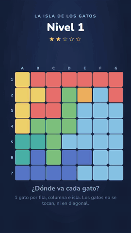</a>
  &nbsp;
  <a href="https://fetnelio.github.io/isla-de-los-gatos/#ep2">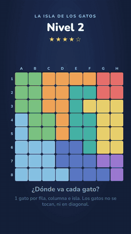</a>
  &nbsp;
  <a href="https://fetnelio.github.io/isla-de-los-gatos/#ep3"></a>
</p>

<p align="center">
  <b>▶ <a href="https://fetnelio.github.io/isla-de-los-gatos/">Ver los videos con sonido</a></b><br>
  <sub>Vista previa acelerada · tocá cada una para ir al video completo.<br>
  Ep. 1 ★★ encierro en una línea · Ep. 2 ★★★★ encierro doble · Ep. 3 ★★★★★ contradicción</sub>
</p>

---

## Episodios

<!-- galeria:inicio -->
**[▶ Ver todos los episodios con reel y story](https://fetnelio.github.io/isla-de-los-gatos/episodios.html)**

<table>
<tr><td align="center"><a href="https://fetnelio.github.io/isla-de-los-gatos/episodios.html#ep1">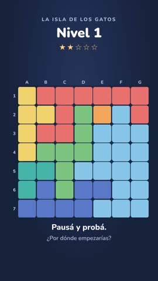</a><br><sub><b>Ep. 1</b> · Piloto<br>★★ · 36 s</sub></td><td align="center"><a href="https://fetnelio.github.io/isla-de-los-gatos/episodios.html#ep2">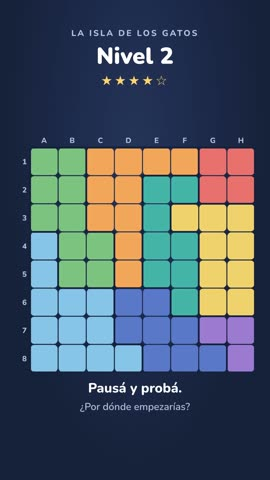</a><br><sub><b>Ep. 2</b> · Piloto<br>★★★★ · 45 s</sub></td><td align="center"><a href="https://fetnelio.github.io/isla-de-los-gatos/episodios.html#ep3">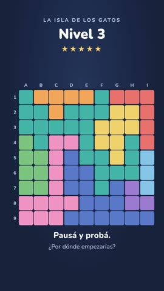</a><br><sub><b>Ep. 3</b> · Piloto<br>★★★★★ · 76 s</sub></td><td align="center"><a href="https://fetnelio.github.io/isla-de-los-gatos/episodios.html#ep4">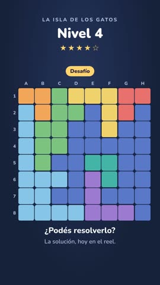</a><br><sub><b>Ep. 4</b> · dom 22/11<br>★★★★ · 50 s</sub></td><td align="center"><a href="https://fetnelio.github.io/isla-de-los-gatos/episodios.html#ep5">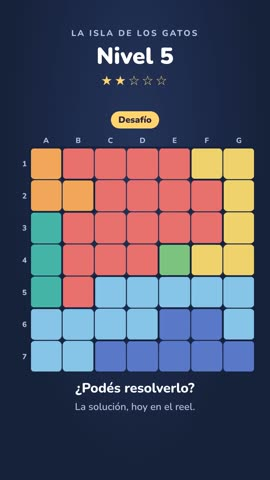</a><br><sub><b>Ep. 5</b> · lun 23/11<br>★★ · 36 s</sub></td><td align="center"><a href="https://fetnelio.github.io/isla-de-los-gatos/episodios.html#ep6">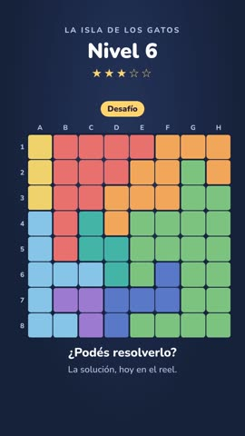</a><br><sub><b>Ep. 6</b> · mar 24/11<br>★★★ · 46 s</sub></td></tr>
<tr><td align="center"><a href="https://fetnelio.github.io/isla-de-los-gatos/episodios.html#ep7">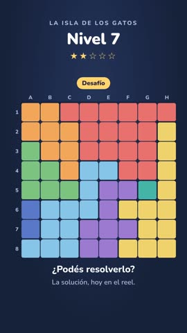</a><br><sub><b>Ep. 7</b> · mié 25/11<br>★★ · 36 s</sub></td><td align="center"><a href="https://fetnelio.github.io/isla-de-los-gatos/episodios.html#ep8">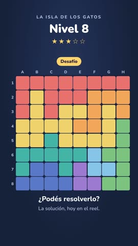</a><br><sub><b>Ep. 8</b> · jue 26/11<br>★★★ · 49 s</sub></td><td align="center"><a href="https://fetnelio.github.io/isla-de-los-gatos/episodios.html#ep9">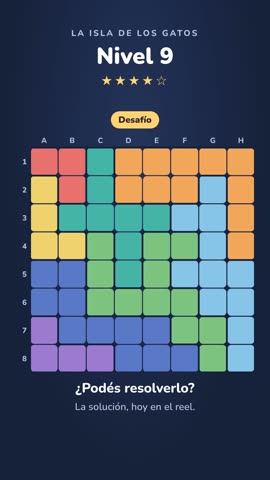</a><br><sub><b>Ep. 9</b> · vie 27/11<br>★★★★ · 52 s</sub></td><td align="center"><a href="https://fetnelio.github.io/isla-de-los-gatos/episodios.html#ep10">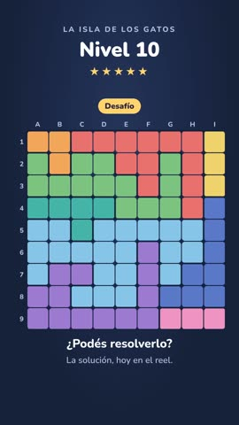</a><br><sub><b>Ep. 10</b> · sáb 28/11<br>★★★★★ · 88 s</sub></td><td align="center"><a href="https://fetnelio.github.io/isla-de-los-gatos/episodios.html#ep11">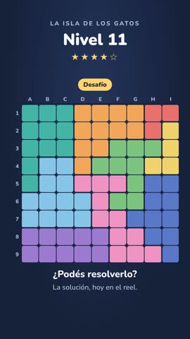</a><br><sub><b>Ep. 11</b> · dom 29/11<br>★★★★ · 62 s</sub></td><td align="center"><a href="https://fetnelio.github.io/isla-de-los-gatos/episodios.html#ep12">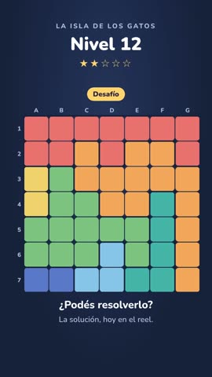</a><br><sub><b>Ep. 12</b> · lun 30/11<br>★★ · 33 s</sub></td></tr>
<tr><td align="center"><a href="https://fetnelio.github.io/isla-de-los-gatos/episodios.html#ep13">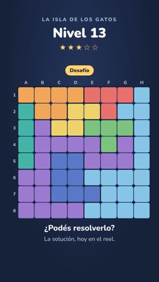</a><br><sub><b>Ep. 13</b> · mar 1/12<br>★★★ · 50 s</sub></td><td align="center"><a href="https://fetnelio.github.io/isla-de-los-gatos/episodios.html#ep14">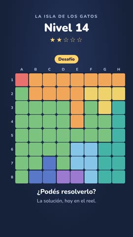</a><br><sub><b>Ep. 14</b> · mié 2/12<br>★★ · 37 s</sub></td><td align="center"><a href="https://fetnelio.github.io/isla-de-los-gatos/episodios.html#ep15">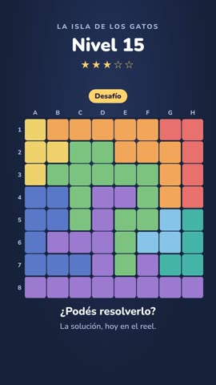</a><br><sub><b>Ep. 15</b> · jue 3/12<br>★★★ · 46 s</sub></td><td align="center"><a href="https://fetnelio.github.io/isla-de-los-gatos/episodios.html#ep16">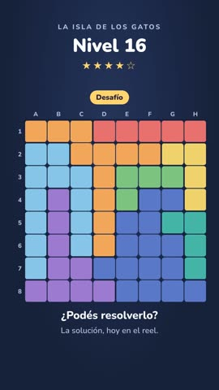</a><br><sub><b>Ep. 16</b> · vie 4/12<br>★★★★ · 62 s</sub></td><td align="center"><a href="https://fetnelio.github.io/isla-de-los-gatos/episodios.html#ep17">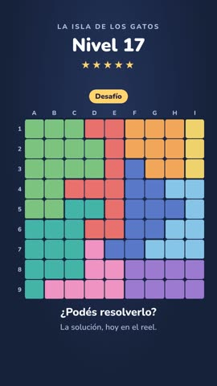</a><br><sub><b>Ep. 17</b> · sáb 5/12<br>★★★★★ · 92 s</sub></td><td align="center"><a href="https://fetnelio.github.io/isla-de-los-gatos/episodios.html#ep18">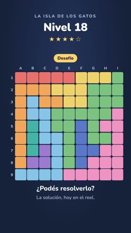</a><br><sub><b>Ep. 18</b> · dom 6/12<br>★★★★ · 62 s</sub></td></tr>
<tr><td align="center"><a href="https://fetnelio.github.io/isla-de-los-gatos/episodios.html#ep19">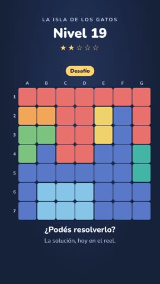</a><br><sub><b>Ep. 19</b> · lun 7/12<br>★★ · 32 s</sub></td><td align="center"><a href="https://fetnelio.github.io/isla-de-los-gatos/episodios.html#ep20">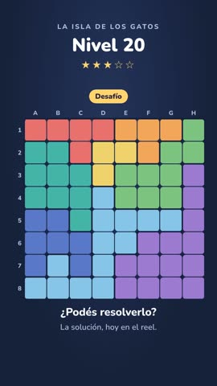</a><br><sub><b>Ep. 20</b> · mar 8/12<br>★★★ · 49 s</sub></td><td align="center"><a href="https://fetnelio.github.io/isla-de-los-gatos/episodios.html#ep21">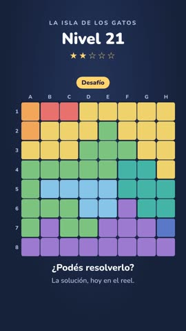</a><br><sub><b>Ep. 21</b> · mié 9/12<br>★★ · 36 s</sub></td><td align="center"><a href="https://fetnelio.github.io/isla-de-los-gatos/episodios.html#ep22">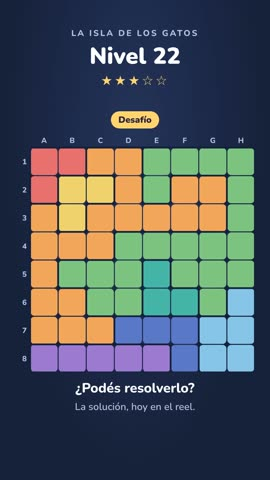</a><br><sub><b>Ep. 22</b> · jue 10/12<br>★★★ · 51 s</sub></td><td align="center"><a href="https://fetnelio.github.io/isla-de-los-gatos/episodios.html#ep23">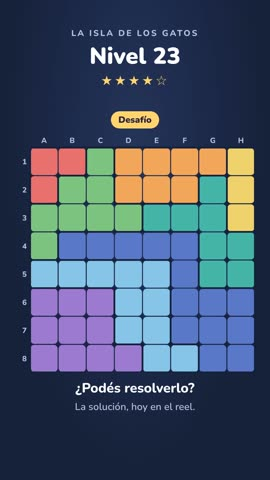</a><br><sub><b>Ep. 23</b> · vie 11/12<br>★★★★ · 60 s</sub></td><td align="center"><a href="https://fetnelio.github.io/isla-de-los-gatos/episodios.html#ep24">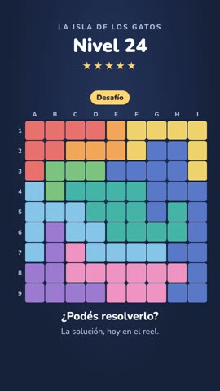</a><br><sub><b>Ep. 24</b> · sáb 12/12<br>★★★★★ · 76 s</sub></td></tr>
<tr><td align="center"><a href="https://fetnelio.github.io/isla-de-los-gatos/episodios.html#ep25">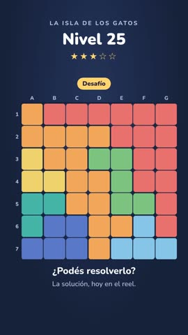</a><br><sub><b>Ep. 25</b> · dom 13/12<br>★★★ · 46 s</sub></td><td align="center"><a href="https://fetnelio.github.io/isla-de-los-gatos/episodios.html#ep26">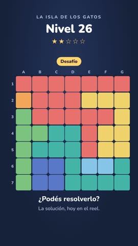</a><br><sub><b>Ep. 26</b> · lun 14/12<br>★★ · 36 s</sub></td><td align="center"><a href="https://fetnelio.github.io/isla-de-los-gatos/episodios.html#ep27">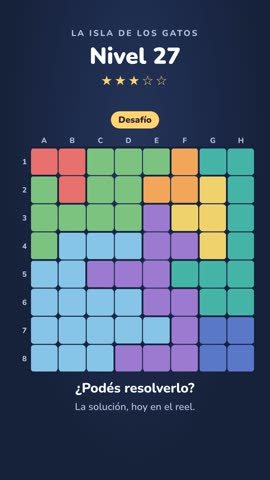</a><br><sub><b>Ep. 27</b> · mar 15/12<br>★★★ · 49 s</sub></td><td align="center"><a href="https://fetnelio.github.io/isla-de-los-gatos/episodios.html#ep28">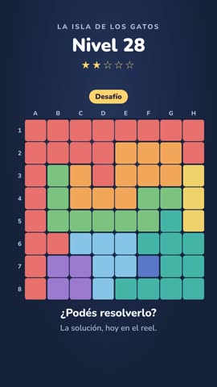</a><br><sub><b>Ep. 28</b> · mié 16/12<br>★★ · 36 s</sub></td><td align="center"><a href="https://fetnelio.github.io/isla-de-los-gatos/episodios.html#ep29">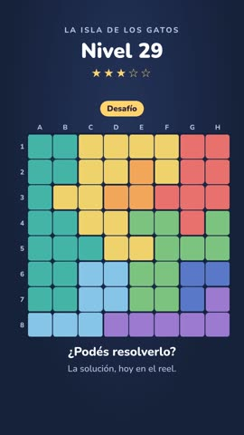</a><br><sub><b>Ep. 29</b> · jue 17/12<br>★★★ · 55 s</sub></td><td align="center"><a href="https://fetnelio.github.io/isla-de-los-gatos/episodios.html#ep30">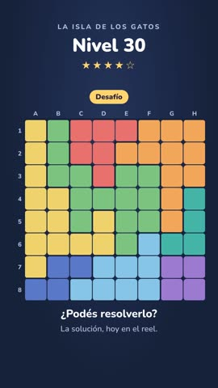</a><br><sub><b>Ep. 30</b> · vie 18/12<br>★★★★ · 62 s</sub></td></tr>
<tr><td align="center"><a href="https://fetnelio.github.io/isla-de-los-gatos/episodios.html#ep31">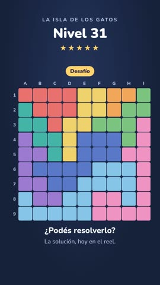</a><br><sub><b>Ep. 31</b> · sáb 19/12<br>★★★★★ · 92 s</sub></td><td align="center"><a href="https://fetnelio.github.io/isla-de-los-gatos/episodios.html#ep32">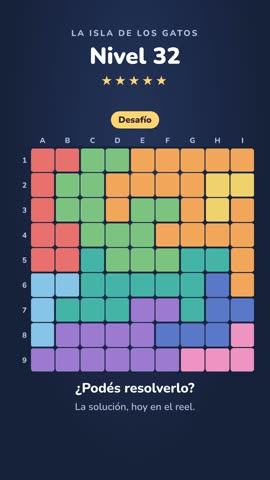</a><br><sub><b>Ep. 32</b> · dom 20/12<br>★★★★★ · 103 s</sub></td><td align="center"><a href="https://fetnelio.github.io/isla-de-los-gatos/episodios.html#ep33">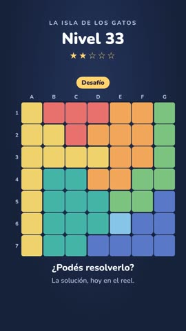</a><br><sub><b>Ep. 33</b> · lun 21/12<br>★★ · 36 s</sub></td></tr>
</table>
<!-- galeria:fin -->

---

## El puzzle

El tablero de N×N está dividido en N **islas** de colores. Hay que ubicar N gatos de forma que haya:

1. **un gato por fila**,
2. **un gato por columna**,
3. **un gato por isla**,
4. y **ningún par de gatos se toque**, ni siquiera en diagonal.

Cada tablero tiene **una sola solución**, y siempre se llega a ella razonando, sin adivinar.

Es el género conocido como **Star Battle** (Hans Eendebak, Campeonato Mundial de Puzzles 2003)
en su versión de una estrella, popularizada como **Queens** en LinkedIn.

## La idea

Un solver por fuerza bruta (*backtracking*) encuentra la respuesta, pero no se parece en nada a cómo piensa una persona.
Este proyecto resuelve cada tablero con una **escalera de tácticas humanas**, siempre usando la más simple que sirva,
y guarda **la evidencia de cada paso**. Ese registro se convierte en el **guion del relator**:

- la primera vez que aparece una táctica, el relator **pregunta** ("¿qué ven en la isla celeste?"), hace una pausa y **explica**;
- las veces siguientes la despacha con una frase corta ("acá lo mismo", "esto ya sabemos cómo sale");
- al final, cuando los gatos caen solos, viene **la cascada**: el momento ASMR, con notas que suben.

Cierre de cada episodio: *"Cada gato en su isla... y cada isla con su gato."* 🐾 *Michi, michi, miau.*

---

## La escalera de tácticas

Todas las imágenes salen de pasos reales del solver, dibujados con el mismo render de los videos.
En el **antes**, el contorno amarillo marca el grupo que se analiza, los anillos punteados sus lugares libres
y los bordes rojos las casillas que se van a tachar.

### 0 · Barrido

Cada gato que se ubica tacha su fila, su columna, su isla y las 8 casillas que lo rodean.
Va incluido en cada paso.

### 1 · Único lugar

> A una isla, fila o columna le queda **una sola casilla libre** → ahí va el gato.


El caso más evidente es una isla de una sola casilla. A medida que se tachan casillas, cualquier grupo puede quedar en esa situación.

### 2 · Encierro en una línea

> Todos los lugares libres de una isla caen en **una misma fila o columna** → esa línea es de la isla: el resto de la línea se tacha.
> (Y al revés: si una fila solo tiene lugar dentro de una isla, el resto de la isla se tacha.)


*"El gato de la isla roja solo puede estar en la fila 1. Así que la fila 1 es suya: el resto se tacha."*

### 3 · Ataque común

> Si **todas** las casillas libres de un grupo atacan a una misma casilla, esa casilla se tacha: pase lo que pase, el gato del grupo la va a tocar.


Es la misma idea que *"si pongo un gato acá, la isla B se queda sin lugar → acá no va"*, vista desde el otro lado.
Cubre los clásicos del dominó (2 casillas) y las formas en L.

### 4 · Encierro doble

> **Dos** grupos que solo caben en **dos** líneas (o islas) → esas líneas son suyas: todo lo demás en ellas se tacha.


*"La fila 6 y la fila 7 solo caben en la isla celeste y la isla azul. Esos lugares son suyos: lo demás se tacha."*

### 5 · Encierro múltiple

> Lo mismo con **k ≥ 3** grupos. Es fácil de enunciar y difícil de ver.


*"La isla azul, la isla violeta y la isla rosa solo caben en la fila 7, la fila 8 y la fila 9."*

### 6 · ¿Y si...? (contradicción)

> Se supone un gato en una casilla. Eso **obliga** a poner otro gato, y entonces algún grupo **se queda sin lugar**. ¡Imposible! → la casilla se tacha.

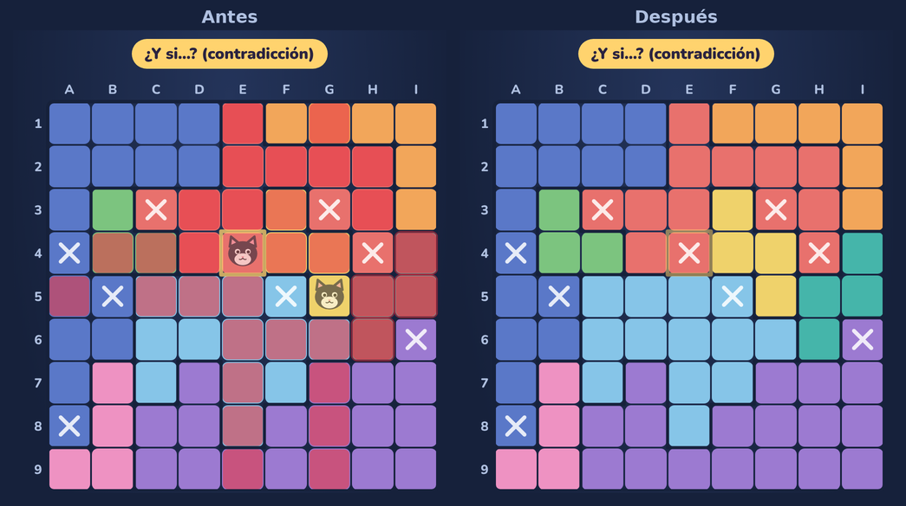

*"Si va en E4, se fuerza un gato en G5... y la isla turquesa se queda sin lugar. ¡Imposible! Entonces E4 es X."*
En rojo, las casillas que atacan los gatos supuestos; con borde rojo, la isla que queda vacía.

### 7 · Contradicción larga

> Igual que la anterior, pero para llegar al absurdo hay que usar tácticas 1 a 5 dentro de la suposición.

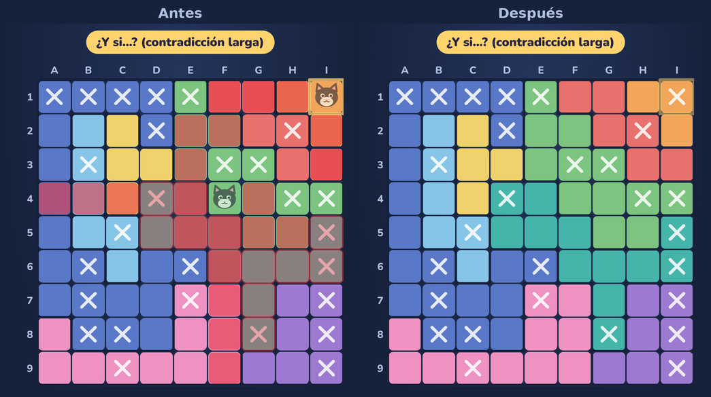

La **dificultad** de un tablero (★ a ★★★★★) es la táctica más alta que necesita.

---

## Cómo se arma un video


- **Generador.** Primero elige la solución y después hace crecer las islas alrededor de cada gato. Con búsqueda local mueve casillas entre islas vecinas hasta que el solver necesite *exactamente* la táctica pedida. Penaliza las islas en forma de serpiente, los tamaños muy desparejos y, en niveles altos, las islas de 1 o 2 casillas.
- **Unicidad gratis.** Cada táctica es una deducción correcta, así que si el solver termina sin adivinar, la solución es única.
- **El ritmo lo marca la voz.** Cada momento dura lo que tarda el relator en decirlo, y el tachado o el gato aparecen al terminar la frase.

## La voz

Para elegirla, se **midió la inteligibilidad** transcribiendo con Whisper frases del guion: ¿se entienden "isla" y "gato"?

| Voz | Motor | "isla" / "gato" entendidos |
|---|---|---|
| es_AR daniela | Piper | 4 / 15 (decía "dato" y "visea") |
| es_MX claude, es_MX ald, es_ES davefx | Piper | 9–12 / 15 |
| **ef_dora, em_alex, em_santa** | **Kokoro** | **15 / 15** |

Por defecto se usa **Kokoro `ef_dora`**. En la contradicción el relator maúlla (*"¡Miau, miau, miau, miáuuu!"*).

## Calibración

Para saber dónde está la dificultad "real" del género:

| Fuente | Resultado |
|---|---|
| 667 niveles oficiales de LinkedIn Queens (estadísticas del solver de [Spiegel](https://mspiegel.github.io/queens-without-backtracking/)) | ~81% necesitan encierro k≥2 · ~16% contradicción |
| 691 niveles comunitarios con solución única ([samimsu/queens-game-linkedin](https://github.com/samimsu/queens-game-linkedin)) | nuestro solver los resuelve **todos** sin backtracking; necesitan desde la táctica 1 hasta la 7 |

Esos niveles se usan solo para calibrar: los videos usan exclusivamente tableros generados acá.

---

## Uso

```bash
pip install -r requirements.txt      # además: ffmpeg, node + playwright
./descargar_voces.sh                 # modelos de Kokoro (~350 MB)

# tablero generado: tamaño, táctica objetivo, semilla, número de episodio
./hacer_video.sh 8 4 5 4

# tablero existente (N líneas de N letras; cada letra es una isla)
./hacer_video.sh episodios/ep3.txt 3

# otra voz o velocidad
VOZ=em_alex VOZ_VEL=1.1 ./hacer_video.sh episodios/ep1.txt 1

# lote diario: calendario + tableros + textos (inicio, cantidad, primer episodio)
python3 lote.py 2026-11-22 30 4
xargs -P 3 -n 1 ./render_episodio.sh < lote/pendientes.txt   # reel + story por episodio

# regenerar las imágenes y GIFs de este README
python3 docs/generar_docs.py

# regenerar la galería de episodios (página + miniaturas + grilla del README)
python3 docs/generar_galeria.py
```

## Publicación diaria

Cada día lleva una **story** (desafío de 10 s: "¿Podés resolverlo? La solución, hoy en el reel")
y un **reel** con la solución completa. El calendario con fechas y textos listos para copiar
está en [`lote/calendario.md`](lote/calendario.md).

| Día | Tablero | Táctica clave | Dificultad |
|---|---|---|---|
| Lunes | 7×7 | Encierro en una línea | ★★ |
| Martes | 8×8 | Ataque común | ★★★ |
| Miércoles | 8×8 | Encierro en una línea | ★★ |
| Jueves | 8×8 | Ataque común | ★★★ |
| Viernes | 8×8 | Encierro doble | ★★★★ |
| Sábado | 9×9 | Contradicción | ★★★★★ |
| Domingo | sorteado | sorteada | sorpresa |

## Estructura

```
solver.py            escalera de tácticas + evidencia de cada paso
generador.py         tableros que piden una táctica objetivo
guion.py             relator: preguntas, explicaciones, frases cortas, cierre (CTAS)
voz.py               Kokoro / Piper + re-timing   (marcas: [miau], [michi])
audio.py             música, notas, ticks, mezcla con la voz
render/              index.html (animación), grabar.js (MP4), cuadros.js (PNG sueltos)
hacer_video.sh       todo el circuito en un comando
lote.py              calendario de episodios diarios + textos para publicar
render_episodio.sh   reel + story de un episodio
backtracking.py      fuerza bruta, solo para verificar unicidad
episodios/           tableros publicados
docs/                sitio de GitHub Pages: index.html, videos/ (reels), stories/, GIFs, tácticas
lote/                calendario.csv / calendario.md con fechas y textos
calibracion/         comparación con niveles de LinkedIn y comunitarios
tableros/            tableros transcriptos de partidas reales
```

## Próximos pasos

- [ ] Intro más corta a partir del segundo episodio.
- [ ] Más variantes de frases del relator, y control automático de inteligibilidad con Whisper.
- [ ] Archivo de episodios para generar en lote y cruzar con la analítica de views.
- [ ] Temporada difícil: variante de 2 gatos por fila, columna e isla (Star Battle clásico).
